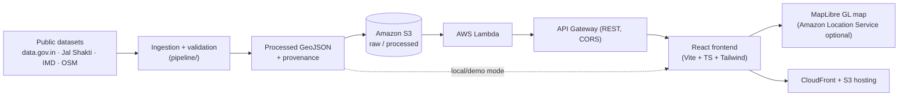

# FloodLens AI 🌊

**Understand Flood History. Explore Water Bodies. Discover Urban Risks.**

An interactive geospatial intelligence platform for exploring **historical** flood
hotspots, flood hazard zones, water bodies, and rainfall observation sites in
**Chennai, Tamil Nadu, India**.

> ⚠️ **Scope:** FloodLens AI is a *historical and geographical* intelligence tool.
> It does **not** provide real-time flood forecasting or predictions. Proximity between a
> flood hotspot and a water body is shown as a geographic fact and does **not** imply causation.

---

## Status

Built in phases (see [`docs/PHASE1_PLAN.md`](docs/PHASE1_PLAN.md)):

- [x] **Phase 1** — Plan, architecture, repository structure, README
- [ ] **Phase 2** — Verify real datasets; build repeatable ingestion → GeoJSON
- [ ] **Phase 3** — React app + interactive Chennai map
- [ ] **Phase 4** — Insights, location details, proximity analysis
- [ ] **Phase 5** — AWS S3 / Lambda / API Gateway / Location Service integration
- [ ] **Phase 6** — Tests + defect resolution (unit, API, component, Playwright E2E)
- [ ] **Phase 7** — Deployment docs + 3-minute demo script

## Architecture



The frontend reads data through a **DataProvider** abstraction. With no AWS configured it
uses bundled local GeoJSON (demo mode); with `VITE_API_BASE` set it uses the AWS REST API.
See [`docs/ARCHITECTURE.md`](docs/ARCHITECTURE.md).

## Quick start (local, no AWS required)

```bash
cd web
npm install
npm run dev
# open http://localhost:5173
```

The app ships with a clearly-labelled demonstration dataset so it is fully usable offline.

## Project layout

```
floodlens-ai/
├── docs/        # plan, architecture, datasets, deployment, testing, demo script
├── data/        # raw / processed GeoJSON + metadata provenance
├── pipeline/    # repeatable ingestion (download → validate → GeoJSON)
├── infra/       # SAM/CloudFormation template + Lambda + IAM policy
└── web/         # React + TypeScript + Vite frontend
```

## Documentation

| Doc | Purpose |
|-----|---------|
| [`docs/PHASE1_PLAN.md`](docs/PHASE1_PLAN.md) | Implementation plan & phase roadmap |
| [`docs/ARCHITECTURE.md`](docs/ARCHITECTURE.md) | Detailed architecture + Mermaid diagrams |
| [`docs/DATASETS.md`](docs/DATASETS.md) | Dataset provenance (source, license, coverage) |
| [`docs/AWS_DEPLOYMENT.md`](docs/AWS_DEPLOYMENT.md) | AWS deployment instructions |
| [`docs/TESTING.md`](docs/TESTING.md) | How to run every test suite |
| [`docs/DEMO_SCRIPT.md`](docs/DEMO_SCRIPT.md) | 3-minute demo script |

## Data integrity principles

- All overview statistics are **computed from loaded data**, never hardcoded.
- Missing attributes render as "not available" — the app **never invents** values.
- Datasets that cannot be verified/downloaded are documented as such, not faked.
- Demonstration data is always **visibly labelled** as demo.

## License

Code: MIT. Datasets retain their original source licenses — see [`docs/DATASETS.md`](docs/DATASETS.md).
