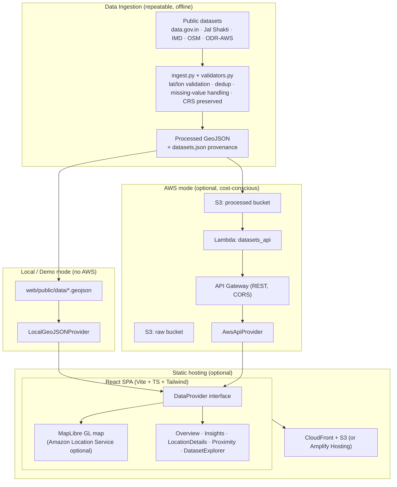

# FloodLens AI — Architecture

## System overview

FloodLens AI is a static single-page React app backed by an optional serverless AWS data
API. The frontend is agnostic to its data source thanks to a `DataProvider` seam: the same
components render whether data comes from bundled local GeoJSON or from API Gateway.



## Provider selection logic

```
VITE_API_BASE set?  ──yes──►  AwsApiProvider (fetch REST)
        │
        no
        ▼
LocalGeoJSONProvider (fetch /data/*.geojson bundled with the SPA)
```

If `AwsApiProvider` throws, the UI surfaces an error state. With
`VITE_FALLBACK_TO_DEMO=true` it falls back to local demo data behind a visible "Demo data" badge.

## Frontend module map

- `types/` — `FloodHotspot`, `WaterBody`, `RainfallSite`, `HazardZone`, `Dataset`. Every
  optional attribute is typed `| null` so the UI can render "not available" rather than invent.
- `lib/geo.ts` — `haversineKm(a, b)`, `nearestWaterBodies(hotspot, bodies, k)`,
  `bbox()`. Pure, unit-tested.
- `lib/stats.ts` — aggregations for the overview cards and Insights charts, all derived
  from loaded features (no constants).
- `data/` — provider interface + two implementations.
- `components/` — presentational + map components; all accept loading/empty/error props.

## AWS backend

- **S3**: two logical buckets (or two prefixes) — `raw/` and `processed/`. Only processed
  GeoJSON is public-read-via-API; raw stays private.
- **Lambda** `datasets_api`: reads processed GeoJSON objects from S3 and returns them as JSON,
  plus a `/datasets` provenance endpoint. Python 3.12, least-privilege role (s3:GetObject on
  the processed bucket only).
- **API Gateway**: REST, CORS restricted to the hosting origin. Routes:
  `GET /flood-hotspots`, `GET /water-bodies`, `GET /rainfall-sites`, `GET /hazard-zones`,
  `GET /datasets`.
- **Amazon Location Service** (optional): a Map resource; the frontend swaps its MapLibre
  style URL to the Location Service style and signs tile requests. Documented, not required.
- **CloudFront + S3**: serves the built SPA.

## Security posture

- No credentials in frontend source. The AWS provider calls only the public REST API.
- IAM least privilege: Lambda role limited to `s3:GetObject` on the processed bucket.
- CORS locked to the known hosting origin (not `*`) in production.
- Secrets (if any ingestion API keys) live in Secrets Manager / `.env` (gitignored), never committed.

## Cost posture

All chosen services are pay-per-use and idle at ~$0: S3 storage of a few MB of GeoJSON,
Lambda invocations only on API calls, API Gateway per-request, CloudFront free-tier-friendly.
Amazon Location Service is the only metered map option and is **off by default**.
